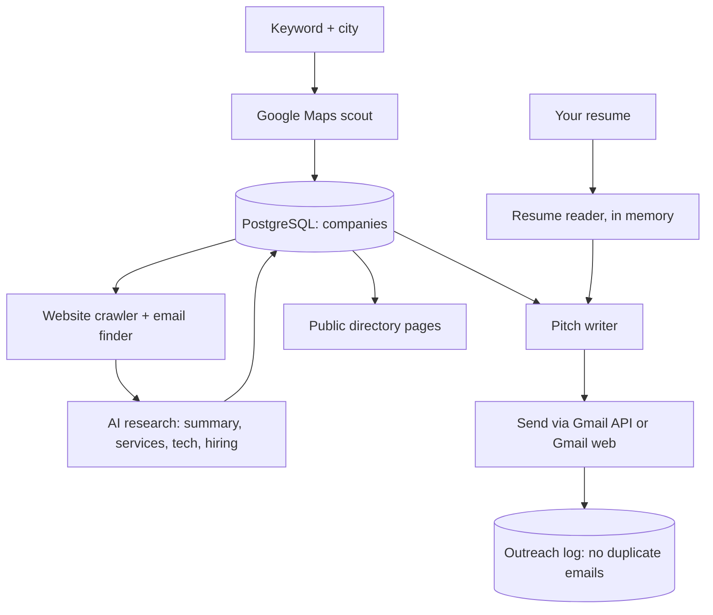

# OutreachPilot

**Find real companies. Get direct emails. Send personal outreach from your own Gmail.**

OutreachPilot is a web app for job seekers and freelancers in India. It finds companies on Google Maps, reads their websites to learn what they do and who to contact, and helps you write and send a personal email to each one. It also publishes a free, public directory of those companies, grouped by city and category.

Live site: [outreachpilot.in](https://outreachpilot.in)

---

## Contents

- [What it does](#what-it-does)
- [How it works](#how-it-works)
- [Tech stack](#tech-stack)
- [Getting started](#getting-started)
- [Configuration](#configuration)
- [Plans and daily limits](#plans-and-daily-limits)
- [Public directory and SEO](#public-directory-and-seo)
- [Background workers](#background-workers)
- [Admin panel](#admin-panel)
- [Pages and API](#pages-and-api)
- [Project layout](#project-layout)
- [Deployment](#deployment)
- [Security](#security)

---

## What it does

1. **Find companies.** Search any keyword and city (for example "Python development companies" in Pune). OutreachPilot collects the matching Google Maps listings: name, website, phone, address, rating and review count. Directories and aggregator sites are filtered out.
2. **Research each company.** It crawls the company website (home, about, contact, careers pages), finds contact emails and sends the text to an AI model. The result is a short summary, the services they offer, the technology they use, and any hiring signals.
3. **Prefer hiring contacts.** When an HR or careers address (`hr@`, `careers@`, `jobs@`, `talent@` and similar) is found, it becomes the main contact instead of `info@` or `sales@`.
4. **Write the email.** Upload your resume (PDF, TXT or Markdown). It is read in memory and never saved to disk. OutreachPilot matches your experience to what the company does and drafts a personal email you can edit.
5. **Send it.** Send through your own Gmail with Google sign-in, open it in Gmail web, or use your mail app. Every send is logged so the same company is never emailed twice.

---

## How it works



---

## Tech stack

| Layer | What is used |
| :--- | :--- |
| Backend | Python 3.11, FastAPI, Uvicorn |
| Database | PostgreSQL (Neon in production), SQLAlchemy 2 |
| Google Maps scouting | SeleniumBase (undetected Chrome) |
| Website crawling | HTTPX, Requests, BeautifulSoup |
| AI | Groq (rotating key pool) with Google Gemini as fallback |
| Sign-in and sending | Google OAuth 2.0, Gmail API |
| Resume reading | pypdf, in memory only |
| Frontend | Jinja2 templates, Tailwind CSS (CDN), vanilla JavaScript, light and dark themes |
| Hosting | Render (web app), GitHub Actions (background workers) |

---

## Getting started

### Requirements

- Python 3.11 or newer
- Google Chrome (only needed for Google Maps scouting)
- A PostgreSQL database, local or hosted (for example Neon)
- At least one AI key: [Groq](https://console.groq.com/) or [Google Gemini](https://aistudio.google.com/)
- Optional: a Google Cloud OAuth client, to send email through Gmail

### Install

```bash
git clone https://github.com/vorarahul4700/outreachPilot.git
```

```bash
cd outreachPilot
```

```bash
python -m venv venv
```

Activate the virtual environment (`venv\Scripts\activate` on Windows, `source venv/bin/activate` on macOS and Linux), then install dependencies:

```bash
pip install -r requirements.txt
```

### Configure

```bash
cp .env.example .env
```

Fill in `.env` (see [Configuration](#configuration)). At minimum you need `DATABASE_URL`, `SECRET_KEY` and one AI key. Generate a secret key with:

```bash
python -c "import secrets; print(secrets.token_urlsafe(64))"
```

### Run

```bash
uvicorn app:app --host 127.0.0.1 --port 8000 --reload
```

Open [http://127.0.0.1:8000](http://127.0.0.1:8000). Tables, columns and indexes are created automatically on first start.

---

## Configuration

All settings are environment variables, read from `.env` locally.

| Variable | Required | Purpose |
| :--- | :--- | :--- |
| `DATABASE_URL` | Yes | PostgreSQL connection string |
| `SECRET_KEY` | Yes | Signs session cookies and encrypts stored Google tokens. The app will not start without it in production |
| `TOKEN_ENC_KEY` | No | Separate key for encrypting Google tokens, so `SECRET_KEY` can be rotated without signing everyone out of Gmail |
| `GROQ_API_KEY` / `GROQ_API_KEYS` | One AI key | Single Groq key, or a comma-separated list that is rotated when one hits its rate limit |
| `GROQ_MODEL` | No | Groq model name |
| `GEMINI_API_KEY` / `GEMINI_API_KEYS` | One AI key | Google Gemini key(s), used as fallback or primary |
| `GEMINI_MODEL` | No | Gemini model name |
| `GOOGLE_CLIENT_ID` | For Gmail | Google OAuth client ID |
| `GOOGLE_CLIENT_SECRET` | For Gmail | Google OAuth client secret |
| `GOOGLE_REDIRECT_URI` | For Gmail | OAuth callback, for example `http://localhost:8000/auth/google/callback` |
| `MASTER_ADMIN_EMAILS` | No | Comma-separated emails that get admin access and no daily limit |
| `APP_BASE_URL` | No | Public base URL used in canonical links and sitemaps |
| `DEV_MODE` | No | `true` only for local development. Enables demo login and sends every email to `DEV_OVERRIDE_EMAIL` |
| `DEV_OVERRIDE_EMAIL` | No | Where all outgoing emails go while `DEV_MODE` is on |
| `MAINTENANCE_MODE` | No | Shows the maintenance page to visitors |
| `SUBSCRIPTION_KILL_SWITCH` | No | Turns off plan limits for everyone (can also be toggled from the admin panel) |
| `PROJECT_NAME`, `TAGLINE`, `APP_DESCRIPTOR` | No | Branding text |

Never commit `.env`. It is already in `.gitignore`.

---

## Plans and daily limits

Each plan has a daily number of pitches a user can send:

| Plan | Pitches per day |
| :--- | :--- |
| Free | 10 |
| Pro | 50 |
| Premium+ | 100 |
| Admin | No limit |

Plans and their limits can be edited from the admin panel.

**Daily reset:** the counter resets automatically at **midnight IST**. Two things make sure this happens:

- Every request checks whether the user's counter is from a previous IST day and resets it if so. A user is never left blocked, even if the server was asleep at midnight.
- A background job also resets everyone just after each midnight IST, so admin numbers stay correct.

**Kill switch:** when switched on (admin panel or `SUBSCRIPTION_KILL_SWITCH`), all limits are lifted for every signed-in user. Their real plan is kept and comes back when it is switched off.

---

## Public directory and SEO

Every company in the database gets a public page, and companies are grouped into crawlable listing pages:

| Page | Example |
| :--- | :--- |
| Directory home | `/directory` |
| City | `/directory/city/bengaluru` |
| Category | `/directory/category/custom-software` |
| City + category | `/directory/companies?city=pune&tech=python` |
| Company profile | `/company/<name>-<id>` |

What the pages include:

- **Structured data** (schema.org JSON-LD): Organization, WebSite, LocalBusiness and breadcrumbs. A rating is only included when the company has real Google reviews.
- **Search engine files:** `robots.txt`, a sitemap index with split sitemaps (core, cities, categories, directory, companies), and `llms.txt` / `llms-full.txt` for AI crawlers.
- **Real data only:** pages show what was actually collected. A company that has not been researched yet says so instead of showing filler text.
- **Caching:** directory data and company details are cached in memory, and pages send long-lived `Cache-Control` headers.

---

## Background workers

Heavy work runs on GitHub Actions, so nothing has to stay running on your computer. All three live in `.github/workflows/`:

| Workflow | Script | When |
| :--- | :--- | :--- |
| Cloud Scout (`cloud_scout.yml`) | `cloud_worker.py` | Every 3 hours, or on demand. Picks queued scouting jobs from the database (`FOR UPDATE SKIP LOCKED`, so parallel runners never collide) and scrapes Google Maps |
| Cloud Enrichment (`cloud_enrich.yml`) | `cloud_enrich.py` | On demand. Crawls and researches pending companies in batches, retrying failures up to 3 times |
| Keep-alive (`keep_alive.yml`) | `curl` | Every 10 minutes. Pings `/healthz` and `robots.txt` so the free Render instance stays awake |

The workers need `DATABASE_URL` and the AI keys set as repository secrets. Enrichment can also be started from your machine:

```bash
python run_cloud_enrichment.py --total 500 --monitor
```

---

## Admin panel

`/admin` is available to admin accounts only. From there you can:

- See users, sign-ups, plans and pitches sent today
- Change a user's plan or daily limit, make someone an admin, or ban an account
- Create and edit plans
- Add companies one at a time or by bulk upload, edit them, and quarantine or restore entries that are not real companies
- Clean up company names and remove non-company listings
- View sent pitches
- Watch and start the GitHub Actions workers
- Toggle the plan kill switch

---

## Pages and API

**Pages**

| Path | What it is |
| :--- | :--- |
| `/` | Landing page |
| `/app` | Workspace: search, filter, research, write and send |
| `/admin` | Admin panel |
| `/directory`, `/directory/...`, `/company/...` | Public directory |
| `/privacy`, `/terms` | Legal pages |
| `/healthz` | Health check |

**Main API endpoints**

| Method | Path | What it does |
| :--- | :--- | :--- |
| `POST` | `/api/scrape` | Start a Google Maps scouting job |
| `GET` | `/api/progress` | Scouting progress and log |
| `POST` | `/api/stop` | Stop the running scouting job |
| `GET` | `/api/companies` | List companies with filters and pagination |
| `GET` | `/api/companies/filters` | Available cities, categories and counts |
| `GET` | `/api/companies/{id}` | One company with its research and emails |
| `POST` | `/api/companies/{id}/enrich` | Research one company now |
| `POST` | `/api/resume/upload` | Read a resume in memory |
| `POST` | `/api/pitch/generate` | Write a pitch for one company |
| `POST` | `/api/pitch/bulk-generate` | Write pitches for several companies |
| `POST` | `/api/pitch/{id}/send-direct` | Send a pitch through Gmail |
| `POST` | `/api/pitch/bulk-send` | Send several pitches, spaced out |
| `GET` | `/api/outreach/logs` | Your sent history |
| `GET` | `/api/auth/status` | Sign-in state, plan and remaining pitches today |
| `GET` | `/auth/google/login` | Start Google sign-in |
| `GET` | `/auth/google/callback` | Google sign-in callback |
| `GET`, `POST` | `/auth/logout` | Sign out |

Admin endpoints live under `/api/admin/` and require an admin account.

---

## Project layout

```
outreachPilot/
├── app.py                   # FastAPI app: pages, API, auth, admin, quota reset
├── db.py                    # SQLAlchemy models, connection, startup migrations
├── config.py                # Settings from environment variables
├── seo_engine.py            # Directory data, slugs, caching, sitemaps, JSON-LD
├── ai_agent.py              # AI calls: company research, resume reading, pitch writing
├── enricher.py              # Website crawler and email finder
├── scraper_engine.py        # Google Maps scraper
├── outreach.py              # Gmail sending
├── cloud_worker.py          # GitHub Actions scouting worker
├── cloud_enrich.py          # GitHub Actions research worker
├── run_cloud_enrichment.py  # Start and watch research runs from your machine
├── templates/               # Jinja2 pages (landing, workspace, admin, directory, company)
├── static/                  # CSS, JavaScript, fonts, images
├── .github/workflows/       # Scout, enrichment and keep-alive workflows
├── render.yaml              # Render service definition
├── render-build.sh          # Render build: Chrome, dependencies, ChromeDriver
├── requirements.txt
└── .env.example             # Template for your .env
```

---

## Deployment

The app runs on [Render](https://render.com) using `render.yaml`:

- **Build:** `render-build.sh` downloads Chrome, installs the Python packages and a matching ChromeDriver.
- **Start:** `uvicorn app:app --host 0.0.0.0 --port $PORT`
- **Health check:** `/healthz`
- **Auto-deploy:** every push to `main` deploys.

Set `DATABASE_URL`, `SECRET_KEY`, your AI keys, the Google OAuth values and `MASTER_ADMIN_EMAILS` in the Render dashboard. Keep `DEV_MODE=false` in production.

---

## Security

- Session cookies are signed, and stored Google tokens are encrypted with `SECRET_KEY` (or `TOKEN_ENC_KEY`).
- Resumes are processed in memory and never written to disk.
- Rate limits protect AI, resume and sending endpoints.
- `DEV_MODE` sends every email to a test address, so nothing reaches real companies during development.
- Database migrations run one step at a time with a lock timeout, so an interrupted start cannot lock the companies table.

Security review notes are in [SECURITY_PENTEST_REPORT_2026-11-14.md](SECURITY_PENTEST_REPORT_2026-11-14.md). To report a security problem, please open a private security advisory on GitHub instead of a public issue.

---

&copy; 2026 OutreachPilot. All rights reserved.
